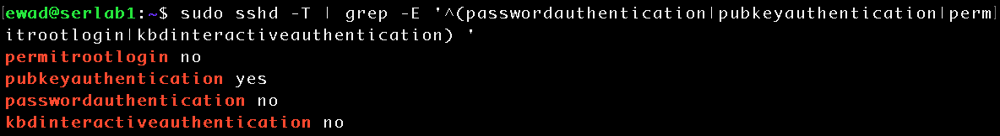
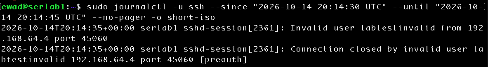
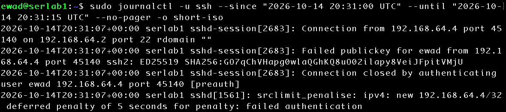
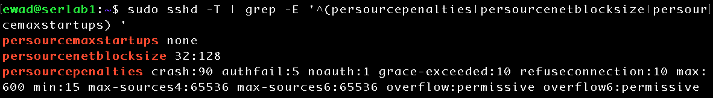
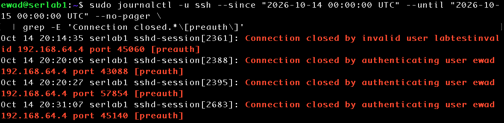

# SSH Authentication Log Analysis and Detection

## Objective

Investigate SSH authentication activity on a hardened Ubuntu Server, compare OpenSSH `INFO` and `VERBOSE` logging, correlate an unauthorized public-key attempt across two systems, and evaluate basic command-line detection queries.

## Environment

| Component | Configuration |
|---|---|
| Hypervisor | UTM on Apple Silicon MacBook Pro |
| Target | `serlab1` — Ubuntu Server 26.04 ARM64 — `192.168.64.2` |
| Test client | `scanlab1` — Ubuntu Server 26.04 ARM64 — `192.168.64.4` |
| MacBook SSH client | `192.168.64.1` |
| Logging | OpenSSH via systemd journal |
| Test date | October 14, 2026 (timestamps below in UTC) |

All testing took place on authorized homelab systems.

## 1. Baseline and final SSH controls

Effective authentication controls were verified with:

```bash
sudo sshd -T | grep -E '^(permitrootlogin|pubkeyauthentication|passwordauthentication|kbdinteractiveauthentication|loglevel) '
```

Final output:

```text
permitrootlogin no
pubkeyauthentication yes
passwordauthentication no
kbdinteractiveauthentication no
loglevel VERBOSE
```

Before the logging change, the effective logging configuration was `loglevel INFO` and `syslogfacility AUTH`. The final `VERBOSE` value shown above was applied later in the lab; it is **not** evidence of the original logging level.



A successful baseline authentication appeared in the journal at **20:06:59 UTC**: `Accepted publickey for ewad from 192.168.64.1 port 54821`, with ED25519 fingerprint `SHA256:wAwd2mnwJbzu+8kd1qLaT8J0TlIiyXu0szEPoDxGtVM`.

## 2. Invalid username test

From `scanlab1`:

```bash
ssh -o BatchMode=yes -o ConnectTimeout=5 \
  -o StrictHostKeyChecking=accept-new \
  labtestinvalid@192.168.64.2
```

The client returned `Permission denied (publickey)`. At **20:14:35 UTC**, `serlab1` logged:

```text
Invalid user labtestinvalid from 192.168.64.4 port 45060
Connection closed by invalid user labtestinvalid 192.168.64.4 port 45060 [preauth]
```



**Finding:** The journal identified the nonexistent username and source address/port. `[preauth]` indicates the connection closed before successful authentication.

## 3. Unauthorized public-key test at INFO level

A temporary Ed25519 key was created on `scanlab1`; its public key was **not** added to the server's authorized keys:

```bash
ssh-keygen -t ed25519 -f /tmp/lab06_unauthorized_key -N "" -C "lab06-test"
```

The client attempted to authenticate as the existing user `ewad` using only that test identity:

```bash
ssh -i /tmp/lab06_unauthorized_key \
  -o IdentitiesOnly=yes -o IdentityAgent=none \
  -o BatchMode=yes -o ConnectTimeout=5 \
  ewad@192.168.64.2
```

The client returned `Permission denied (publickey)`. Under the original `INFO` logging level, the server journal included two distinct connection closures:

```text
20:20:05 Connection closed by authenticating user ewad 192.168.64.4 port 43088 [preauth]
20:20:27 Connection closed by authenticating user ewad 192.168.64.4 port 57854 [preauth]
```

These records do not independently identify a rejected key, and the evidence does not establish why two separate connections occurred.

## 4. Improve logging visibility with VERBOSE

An isolated SSH configuration drop-in was created on `serlab1`:

```bash
printf 'LogLevel VERBOSE\n' | sudo tee /etc/ssh/sshd_config.d/05-lab06-logging.conf
sudo sshd -T | grep -E '^(loglevel|syslogfacility) '
sudo systemctl reload ssh
```

Effective configuration showed `loglevel VERBOSE` and `syslogfacility AUTH`. Repeating the unauthorized-key test produced the following events at **20:31:07 UTC**:

```text
Connection from 192.168.64.4 port 45140 on 192.168.64.2 port 22 rdomain ""
Failed publickey for ewad from 192.168.64.4 port 45140 ssh2: ED25519 SHA256:GO7qChVHapg0wlaQGhKQ8uO02ilapy8VeiJFpitVMjU
Connection closed by authenticating user ewad 192.168.64.4 port 45140 [preauth]
```



**Finding:** `VERBOSE` recorded the explicit `Failed publickey` event and the rejected key's SHA256 fingerprint, improving investigative detail without relaxing authentication restrictions.

## 5. Correlate the rejected key across systems

On `scanlab1`:

```bash
ssh-keygen -lf /tmp/lab06_unauthorized_key.pub -E sha256
```

Output:

```text
256 SHA256:GO7qChVHapg0wlaQGhKQ8uO02ilapy8VeiJFpitVMjU lab06-test (ED25519)
```


The client-side fingerprint **exactly matched** the fingerprint in `serlab1`'s failed-public-key journal entry. This directly correlates the known test key with the server-side rejection.

## 6. Source-based authentication penalties

Following the rejected key, OpenSSH logged:

```text
srclimit_penalise: ipv4: new 192.168.64.4/32 deferred penalty of 5 seconds for penalty: failed authentication
```

Effective settings were inspected with:

```bash
sudo sshd -T | grep -E '^(persourcepenalties|persourcenetblocksize|persourcemaxstartups) '
```

```text
persourcemaxstartups none
persourcenetblocksize 32:128
persourcepenalties crash:90 authfail:5 noauth:1 grace-exceeded:10 refuseconnection:10 max:600 min:15 max-sources4:65536 max-sources6:65536 overflow:permissive overflow6:permissive
```



The `authfail:5` setting assigns five seconds for failed authentication; `min:15` is the minimum accumulated penalty before enforcement. The observed *deferred* five-second penalty **does not establish that the client was blocked**. `persourcenetblocksize 32:128` tracks individual IPv4 and IPv6 addresses, while `persourcemaxstartups none` indicates no additional per-source unauthenticated connection limit.

## 7. Detection queries and their limitations

An initial query selected explicit success/failure categories:

```bash
sudo journalctl -u ssh --since "today" --no-pager \
  | grep -E 'Failed publickey|Invalid user|Accepted publickey'
```

It returned **one** `Accepted publickey` message, **one** `Invalid user` message, and **one** `Failed publickey` message. Separate `grep -c` checks confirmed one explicit failed-public-key message and one invalid-user message.

Aggregating source IPs for the two selected failure categories:

```bash
sudo journalctl -u ssh --since "today" --no-pager \
  | grep -E 'Failed publickey|Invalid user' \
  | grep -oE 'from ([0-9]{1,3}\.){3}[0-9]{1,3}' \
  | awk '{print $2}' | sort | uniq -c | sort -nr
```

Result:

```text
2 192.168.64.4
```

**Important limitation:** That count describes two matching *messages*, not the total number of unsuccessful connections. It misses earlier `INFO`-level preauthentication closures.

The query was expanded:

```bash
sudo journalctl -u ssh --since "today" --no-pager \
  | grep -E 'Invalid user|Failed publickey|Connection closed.*\[preauth\]'
```

This returned **six messages** describing **four distinct connections** that ended before successful authentication:

| Time (UTC) | Source port | Username | Evidence |
|---|---:|---|---|
| 20:14:35 | 45060 | `labtestinvalid` | Invalid user; preauth closure |
| 20:20:05 | 43088 | `ewad` | Preauth closure |
| 20:20:27 | 57854 | `ewad` | Preauth closure |
| 20:31:07 | 45140 | `ewad` | Failed public key; preauth closure |

All four originated from `192.168.64.4`. Source ports and SSH session identifiers distinguish connections; multiple messages can describe the same connection. A `[preauth]` closure alone does **not** prove that a credential or key was rejected.



**Finding:** Detection accuracy depends on logging level, event selection, and correlation. Counting matching lines without identifying unique connections can undercount relevant activity or double-count individual connections.

## 8. Final configuration validation

On `serlab1`:

```bash
sudo sshd -t && sudo sshd -T | grep -E '^(loglevel|passwordauthentication|pubkeyauthentication|permitrootlogin|kbdinteractiveauthentication) '
```

Output:

```text
permitrootlogin no
pubkeyauthentication yes
passwordauthentication no
kbdinteractiveauthentication no
loglevel VERBOSE
```

`sshd -t` completed successfully, confirming valid configuration syntax. The authentication restrictions remained intact. `VERBOSE` was retained for future homelab monitoring; production environments should evaluate the additional log volume and metadata exposure.

## Key takeaways

- Hardened public-key-only SSH authentication rejected the tested unauthorized connections.
- `VERBOSE` logging revealed the rejected key fingerprint and an explicit failure event not visible in the earlier `INFO` records.
- Matching SHA256 fingerprints established cross-host correlation between the test key and server rejection.
- OpenSSH recorded a deferred source penalty, but no enforced block was demonstrated.
- Simple `journalctl`, `grep`, `awk`, `sort`, and `uniq` pipelines supported initial detection and aggregation.
- Accurate security analysis requires distinguishing event messages from unique connections and understanding what the logs do **not** prove.

## Skills demonstrated

Linux administration · OpenSSH configuration validation · SSH authentication analysis · systemd journal querying · controlled security testing · public-key fingerprint correlation · log aggregation · detection refinement · evidence-based technical documentation

